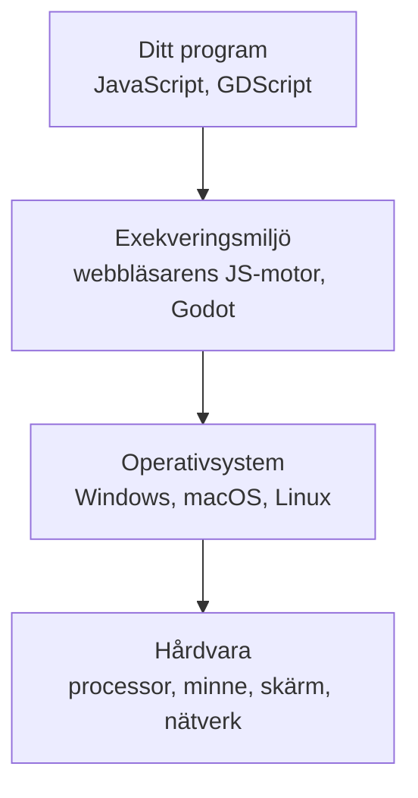
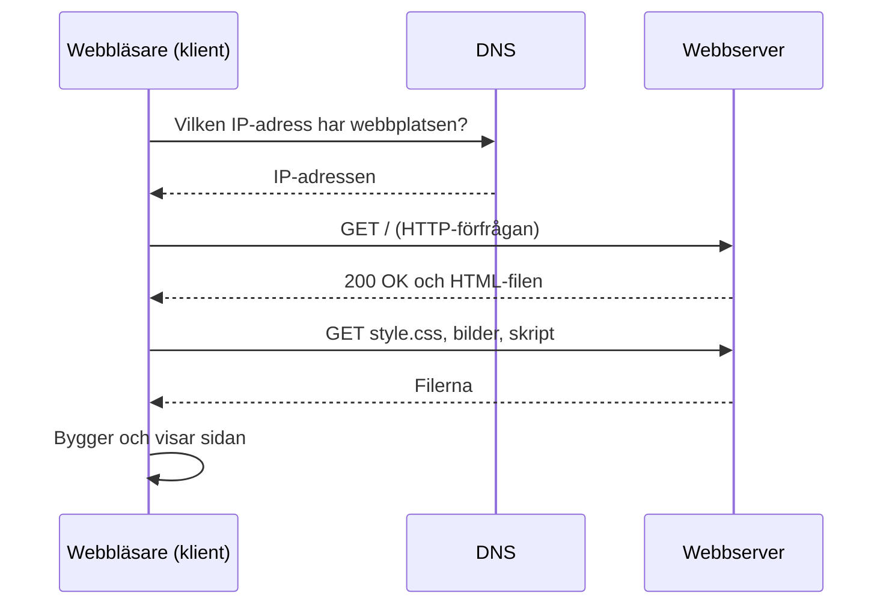

# Kapitel 1: Datorn, programmen och webben

> **I det här kapitlet lär du dig**
> - vad ett program är och hur datorn kör det
> - varför datorer är snabba men ändå har tydliga begränsningar
> - hur program, exekveringsmiljö, operativsystem och hårdvara samarbetar
> - vad som skiljer programspråken i kursen åt
> - vad som händer när du öppnar en webbsida

Under den här kursen kommer du att skriva kod som körs i en webbläsare, på en liten mikrokontroller och i en spelmotor. Det ser ut som tre helt olika världar, men under ytan gäller samma regler. Den som förstår reglerna blir mycket bättre på att lösa problem när något krånglar.

## Vad är ett program?

Ett program är en följd av instruktioner som en dator kan utföra. Datorn tänker inte och gissar inte vad du menade. Den gör exakt det som står, i tur och ordning, tills programmet säger något annat. Det är både styrkan och svagheten: samma instruktioner ger samma resultat en miljard gånger, men ett litet misstag upprepas lika troget.

Att programmera är därför två saker samtidigt: att förstå ett problem så väl att du kan beskriva lösningen steg för steg, och att skriva ner stegen i ett språk som datorn kan köra.

## Hur datorn kör ett program

En dator består i grunden av en **processor** (CPU), som utför instruktioner, och ett **arbetsminne** (RAM), som håller både instruktionerna och den data de arbetar med. Processorn upprepar samma cykel om och om igen:

1. **Hämta** nästa instruktion från minnet.
2. **Avkoda** den, det vill säga ta reda på vad den betyder.
3. **Utför** den, till exempel en addition eller en jämförelse.

Allt i minnet lagras som **bitar**, ettor och nollor. Åtta bitar kallas en **byte**. Med *n* bitar kan du skilja på 2ⁿ olika värden, så en byte räcker till 2⁸ = 256 värden, till exempel talen 0 till 255.

**Genomräknat exempel: binära tal.** I det binära talsystemet är varje position värd dubbelt så mycket som positionen till höger. Talet `1011` blir:

| Position | 8 | 4 | 2 | 1 |
|---|---|---|---|---|
| Bit | 1 | 0 | 1 | 1 |
| Värde | 8 | 0 | 2 | 1 |

Summan är 8 + 0 + 2 + 1 = 11. Text, bilder och ljud lagras på samma sätt: varje bokstav eller bildpunkt motsvaras av ett tal enligt en överenskommen kod.

## Möjligheter och begränsningar

Datorer är bra på det som går att beskriva exakt: räkna, sortera, söka, jämföra och upprepa. En vanlig processor hinner utföra miljarder enkla instruktioner varje sekund. De är sämre på sådant som kräver sunt förnuft eller som saknar ett tydligt rätt svar. Några begränsningar kommer du att stöta på i praktiken:

- **Ändlig precision.** Ett tal lagras med ett bestämt antal bitar, och många decimaltal går inte att skriva exakt i binär form. Skriv `0.1 + 0.2` i webbläsarens konsol så får du `0.30000000000000004`. Det är inte ett fel i JavaScript utan en följd av hur decimaltal lagras.
- **Ändligt minne.** En laptop har gott om arbetsminne, men en mikrokontroller som ESP8266 har väldigt lite. Där märks det snabbt om du sparar för mycket data.
- **Tid.** En algoritm som måste testa alla kombinationer kan bli så långsam att den aldrig blir klar, även på en snabb dator.
- **Beräkningsbarhet.** Vissa frågor kan inget program besvara i alla lägen. Det kända *stopproblemet* säger att det inte går att skriva ett program som för varje tänkbart program avgör om det någon gång stannar.
- **Datan styr.** Ett program som fattar beslut utifrån dålig eller snedvriden data ger dåliga beslut. Det återkommer vi till i [kapitel 10](10-generativ-ai-och-etik.md).

## Lagren mellan din kod och hårdvaran

Din kod pratar sällan direkt med processorn. Mellan dem finns flera lager, och varje lager döljer detaljer för lagret ovanför.

- **Exekveringsmiljön** är det program som kör din kod. JavaScript körs av en motor inuti webbläsaren, som också ger tillgång till sidan och nätverket. Motorn ser till att din kod kan köras på vilken dator som helst som har webbläsaren.
- **Operativsystemet** fördelar processorns tid mellan alla program, håller reda på filer och ger program ett gemensamt sätt att använda skärm, tangentbord och nätverk.
- **Hårdvaran** utför till slut arbetet.

Följ ett klick genom lagren: tangentbordet eller musen skickar en signal till datorn, operativsystemet talar om för webbläsaren vad som hänt, webbläsaren kör din JavaScript-funktion och ritar om sidan. Allt det händer på en bråkdel av en sekund.

På en ESP8266 ser det annorlunda ut. Där kompileras din C++-kod till maskinkod som läggs direkt i mikrokontrollerns minne. Det finns inget Windows eller macOS där, bara ditt program och ett färdigt bibliotek som sköter till exempel Wi-Fi. Det förklarar varför du måste tänka mer på minne och tid i [kapitel 7](07-esp8266-och-cpp.md).

## Programspråk och paradigm

Datorn förstår bara maskinkod. Allt annat måste översättas. En **kompilator** översätter hela programmet i förväg, medan en **tolk** läser och kör koden under tiden. Moderna JavaScript-motorer gör en blandning: de kompilerar medan programmet körs.

Ett **programmeringsparadigm** är ett sätt att tänka när du bygger ett program. Samma språk kan stödja flera paradigm.

| Språk | Används till | Körs av | Paradigm och stil |
|---|---|---|---|
| HTML | Webbsidors struktur | Webbläsaren | Märkspråk, inget programspråk: du beskriver vad som finns |
| CSS | Webbsidors utseende | Webbläsaren | Deklarativt: du beskriver hur det ska se ut |
| JavaScript | Logik på webben | Webbläsarens motor eller Node.js | Imperativt, händelsestyrt, objektorienterat, funktionellt |
| C++ | Mikrokontrollern | Kompileras till maskinkod | Imperativt, objektorienterat |
| GDScript | Spel i Godot | Godot-motorn | Objektorienterat, händelsestyrt |
| Python | Bland annat robotik med ROS 2 | Python-tolken | Imperativt, objektorienterat |

**Imperativt** betyder att du skriver ner stegen som ska utföras. **Objektorienterat** betyder att programmet byggs av objekt som håller både data och beteende. **Händelsestyrt** betyder att kod körs när något händer, till exempel ett klick. **Deklarativt** betyder att du beskriver resultatet och låter någon annan lista ut hur.

## Webben: klient och server

Internet är nätet av sammankopplade datorer. Webben är en tjänst som använder det nätet. När du skriver en adress i webbläsaren händer ungefär detta:

**Klienten** är den som frågar, här din webbläsare. **Servern** är den som svarar. Språket de använder heter **HTTP** och beskrivs mer i [kapitel 8](08-http-databas-webbapp.md). HTML, CSS och JavaScript körs i klienten, på din dator. Annan kod körs på servern och kan till exempel läsa en databas. Det här är grunden för webbappen du bygger senare i kursen.

## Verktygen du använder

Du skriver koden i en **kodredigerare**, i den här kursen Visual Studio Code. Ett **IDE** (integrated development environment) är ett program som samlar redigering, körning och felsökning på samma ställe. Arduino IDE och Godots redigerare är två exempel som du möter senare. Du sparar dina övningar med **GitHub Classroom** redan från start. Exakt vad som händer när du gör det lär du dig i [kapitel 6](06-versionshantering.md).

Webbläsarens **utvecklarverktyg** (tangenten F12) är ett av dina viktigaste hjälpmedel. Fliken Console visar utskrifter och felmeddelanden, och fliken Network visar varje HTTP-förfrågan sidan gör.

## Begrepp

- **Program:** en följd av instruktioner som en dator kan utföra
- **Processor (CPU):** den del av datorn som utför instruktioner
- **Arbetsminne (RAM):** snabbt minne som håller instruktioner och data medan programmet körs
- **Bit och byte:** en bit är en etta eller nolla, en byte är åtta bitar
- **Exekveringsmiljö:** det program eller system som kör din kod
- **Kompilator och tolk:** en kompilator översätter koden i förväg, en tolk kör den medan den läses
- **Paradigm:** ett sätt att tänka och strukturera ett program
- **Klient och server:** den som ställer en fråga och den som svarar
- **IDE:** ett program som samlar verktygen för programutveckling

## Testa dig själv

1. Vilka tre steg upprepar processorn hela tiden?
2. Varför ger `0.1 + 0.2` inte exakt `0.3` i JavaScript?
3. Vad gör operativsystemet som ett program inte behöver göra självt?
4. Vad är skillnaden mellan exekveringsmiljön för JavaScript och den för din kod på en ESP8266?
5. Varför är HTML inte ett programspråk?
6. Ge ett exempel på något som passar en dator bra och något som passar den dåligt, och motivera.
7. Vad är skillnaden mellan internet och webben?

## Övningar

**Grund 1.** Omvandla det binära talet `1101` till ett decimaltal.

Svar
8 + 4 + 0 + 1 = 13

**Grund 2.** Hur många olika värden kan lagras i 16 bitar?

Svar
216 = 65 536 värden

**Grund 3.** Öppna en webbsida, tryck F12 och öppna fliken Network. Ladda om sidan. Hur många förfrågningar görs? Vilken statuskod har den första?

**Vidare 4.** Skriv `0.1 + 0.2 === 0.3` i konsolen. Vad blir resultatet? Hur borde du jämföra decimaltal i stället?

Svar
Resultatet är <code>false</code>. Jämför i stället om skillnaden är väldigt liten, till exempel <code>Math.abs((0.1 + 0.2) - 0.3) &lt; 0.000001</code>, vilket ger <code>true</code>.

**Utmaning 5.** Rita din egen bild av vad som händer från det att du trycker på en knapp på en webbsida tills texten på sidan ändras. Ta med alla lager från det här kapitlet.

## Koppling till projektet

Kapitlet ger bakgrunden till [Programmeringsintroduktion](../projekt/programmeringsintroduktion/README.md), där du börjar skriva kod för webben. Det förklarar också varför du senare i [Hetaste Laget PROG](../projekt/hetaste-laget/README.md) måste tänka annorlunda på en mikrokontroller än i en webbläsare. På provet ska du kunna förklara hur språken fungerar och vad de används till.

## Läs mer

- [Kursens presentation om webben](https://github.com/abbindustrigymnasium/programmering1/blob/main/Webben.pptx)
- [MDN: Hur webben fungerar](https://developer.mozilla.org/en-US/docs/Learn_web_development/Getting_started/Web_standards/How_the_web_works)
- [MDN: JavaScript-datatyper och talens precision](https://developer.mozilla.org/en-US/docs/Web/JavaScript/Reference/Global_Objects/Number)

[Innehåll](../README.md) | [Nästa →](02-html-och-css.md)
