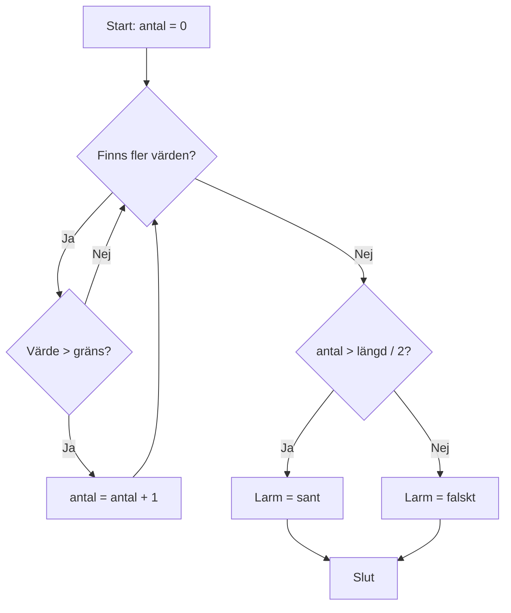

# Kapitel 4: Problemlösning, felsökning och god kod

> **I det här kapitlet lär du dig**
> - att arbeta metodiskt med problem innan du skriver kod
> - att använda pseudokod och flödesdiagram
> - att skilja på syntaxfel, logiska fel och exekveringsfel
> - att fånga fel med undantagshantering
> - att skriva kod som går att läsa, även för dig själv om tre månader

Att skriva kod är ofta den lätta delen. Det svåra är att veta vad koden ska göra och att hitta varför den inte gör det. De som är bra på programmering har sällan färre fel än andra. De har bara bättre metoder för att hitta dem.

## Strukturerad problemlösning

Ett sätt att arbeta som fungerar på små och stora problem:

1. **Förstå problemet.** Vad ska in i programmet och vad ska ut? Vilka specialfall finns?
2. **Dela upp det.** Kan du lösa delarna var för sig?
3. **Planera.** Skriv lösningen i pseudokod eller rita ett diagram.
4. **Skriv kod i små steg.** Testa varje liten del innan du går vidare.
5. **Testa med flera värden**, inklusive konstiga värden.

**Pseudokod** är en beskrivning av en algoritm på vanligt språk, utan hänsyn till syntax. Ett **flödesdiagram** visar samma sak som en bild.

### Genomgånget exempel: larm för höga temperaturer

Problemet: du har en lista med mätvärden och ett gränsvärde. Programmet ska tala om hur många värden som är över gränsen, och om de är fler än hälften ska det larma.

**Indata:** lista med tal, gränsvärde. **Utdata:** antal över gränsen, larm ja eller nej.

Pseudokod:

```text
sätt antal till 0
för varje värde i listan:
    om värdet är större än gränsen:
        öka antal med 1
om antal är större än halva listans längd:
    larm är sant
annars:
    larm är falskt
returnera antal och larm
```

Samma logik som flödesdiagram:



När planen är klar är koden nästan bara en översättning:

```js
function kontrolleraMatningar(varden, grans) {
  let antalOver = 0;
  for (const varde of varden) {
    if (varde > grans) {
      antalOver++;
    }
  }
  return { antalOver, larm: antalOver > varden.length / 2 };
}

console.log(kontrolleraMatningar([24, 26, 27, 22], 25)); // { antalOver: 2, larm: false }
console.log(kontrolleraMatningar([26, 27, 28, 22], 25)); // { antalOver: 3, larm: true }
```

Tänk ut testfall i förväg. Vad ska hända precis på gränsen?

| Indata | Gräns | Förväntat `antalOver` | Förväntat `larm` | Varför testet finns |
|---|---|---|---|---|
| `[24, 26, 27, 22]` | 25 | 2 | false | exakt hälften ska inte larma |
| `[26, 27, 28, 22]` | 25 | 3 | true | fler än hälften |
| `[25, 25]` | 25 | 0 | false | värdet på gränsen räknas inte |
| `[]` | 25 | 0 | false | tom lista ska inte krascha |

## Tre sorters fel

| Feltyp | Vad det betyder | Exempel | Hur du märker det |
|---|---|---|---|
| Syntaxfel | Koden följer inte språkets regler | Glömd parentes | Felmeddelande innan programmet körs |
| Exekveringsfel | Koden är korrekt skriven men kraschar under körning | Du läser en egenskap på `undefined` | Felmeddelande under körning |
| Logiskt fel | Koden körs utan fel men gör fel sak | `>` där det skulle vara `>=` | Bara att svaret blir fel |

Logiska fel är svårast, eftersom datorn inte klagar. Därför behöver du testfall.

**Så hittar och förebygger du fel:**

- **Läs felmeddelandet.** Det säger oftast både vad som är fel och på vilken rad.
- **Skriv ut mellanvärden** med `console.log`. Stämmer de med det du väntar dig?
- **Använd en debugger.** I utvecklarverktygen kan du klicka på en rad för att sätta en **brytpunkt**. Programmet pausar där och du kan gå fram rad för rad.
- **Gör problemet litet.** Ta bort kod tills du har det minsta exemplet som fortfarande ger felet.
- **Förklara koden högt** för en kompis eller en gummianka. Ofta hittar du felet medan du pratar.
- **Testa ofta.** Ett fel är lätt att hitta om du bara ändrat tre rader sedan det senast fungerade.

## Undantagshantering

Vissa fel går inte att undvika, till exempel att nätet är nere eller att användaren skrivit något konstigt. Ett **undantag** (exception) är ett fel som kan fångas så att programmet inte kraschar. Du kastar ett undantag med `throw` och fångar det med `try` och `catch`.

```js
function tolkaMatning(text) {
  const varde = Number(text);
  if (Number.isNaN(varde)) {
    throw new Error(`"${text}" är inte ett tal`);
  }
  return varde;
}

for (const inmatning of ["21.5", "varmt"]) {
  try {
    console.log("Värde:", tolkaMatning(inmatning));
  } catch (fel) {
    console.log("Kunde inte läsa mätningen:", fel.message);
  }
}
// Värde: 21.5
// Kunde inte läsa mätningen: "varmt" är inte ett tal
```

Fånga bara fel du kan göra något åt, och visa användaren något begripligt. Ett `catch` som är tomt döljer problemet och gör det svårare att hitta senare.

## Kod som går att läsa

Det är svårare att läsa kod än att skriva den. Jämför:

```js
function f(a, b) {
  let c = 0;
  for (const d of a) { if (d > b) c++; }
  return c;
}
```

Med samma kod men goda namn och struktur blir det:

```js
// Räknar hur många mätvärden som är större än gränsvärdet.
function antalOverGrans(matvarden, gransvarde) {
  let antal = 0;
  for (const varde of matvarden) {
    if (varde > gransvarde) {
      antal++;
    }
  }
  return antal;
}
```

Några tumregler:

- **Namn** ska säga vad något är. Skriv ut hela ord, använd ett och samma språk och samma stil, till exempel `antalMatningar`.
- **Kommentarer** ska förklara *varför*, inte upprepa vad koden gör. `// öka i med 1` tillför ingenting, men `// sensorn behöver två sekunder för att starta` gör det.
- **Funktioner** ska göra en sak och ha ett namn som säger vad.
- **Indentera** konsekvent. Formatera koden automatiskt i VS Code med Format Document.
- **Undvik magiska tal.** Skriv `const GRANSVARDE = 25;` i stället för att låta `25` stå mitt i koden.

## Begrepp

- **Pseudokod:** en algoritm beskriven på vanligt språk
- **Flödesdiagram:** en bild av hur ett program går från steg till steg
- **Syntaxfel:** koden följer inte språkets regler
- **Exekveringsfel:** koden kraschar när den körs
- **Logiskt fel:** koden körs, men gör fel sak
- **Brytpunkt:** en rad där debuggern pausar programmet
- **Undantag:** ett fel under körningen som kan fångas och hanteras

## Testa dig själv

1. Varför ska du planera innan du skriver kod, även för små problem?
2. Vad är skillnaden mellan ett syntaxfel och ett logiskt fel?
3. Varför är logiska fel svårast att hitta?
4. Vad är en brytpunkt och vad använder du den till?
5. När ska du använda `try` och `catch`?
6. Varför är ett tomt `catch` dåligt?
7. Vad är ett bra och ett dåligt exempel på en kommentar?

## Koppling till projektet

Metoderna här används i alla projekt, och särskilt på provet i [Programmeringsintroduktion](../projekt/programmeringsintroduktion/README.md). Pseudokod och flödesdiagram är en del av planeringen i [2D-Spel](../projekt/2d-spel/README.md), och felsökning av hela kedjan från sensor till skärm behövs i [Hetaste Laget PROG](../projekt/hetaste-laget/README.md).

## Läs mer

- [MDN: Vad gick fel? Felsökning av JavaScript](https://developer.mozilla.org/en-US/docs/Learn_web_development/Core/Scripting/What_went_wrong)
- [MDN: try...catch](https://developer.mozilla.org/en-US/docs/Web/JavaScript/Reference/Statements/try...catch)
- [Chrome DevTools: felsöka JavaScript](https://developer.chrome.com/docs/devtools/javascript)

[← Föregående](03-javascript-grunder.md) | [Innehåll](../README.md) | [Nästa →](05-dom-och-granssnitt.md)
