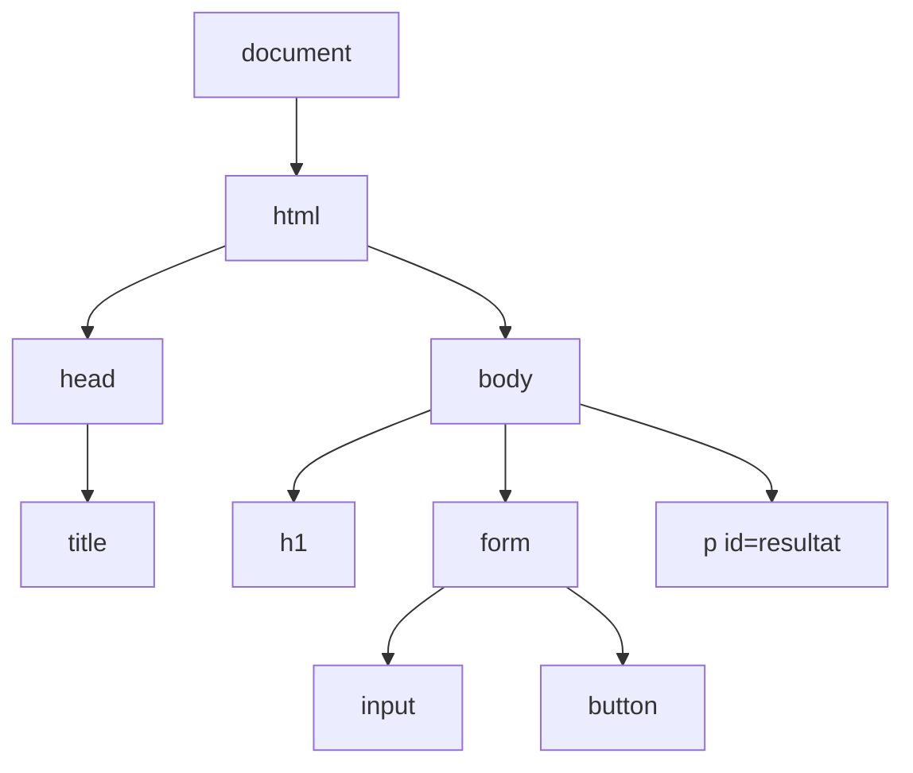

# Kapitel 5: DOM och användargränssnitt

> **I det här kapitlet lär du dig**
> - vad DOM är och hur JavaScript kommer åt sidan
> - att hitta och ändra element
> - att reagera på klick och inmatning
> - att ta emot och kontrollera användarens värden
> - att bygga ett gränssnitt som är anpassat för den som ska använda det

Hittills har din JavaScript bara pratat med konsolen. Nu ska den få ta tag i sidan. Med några få rader kod kan en knapp räkna, ett fält uppdatera en text och en lista växa medan användaren tittar på. Det är här webbsidan blir ett program.

## Vad är DOM?

När webbläsaren läser din HTML bygger den en trädstruktur i minnet. Trädet kallas **DOM**, Document Object Model. Varje element blir ett objekt, och JavaScript kan läsa och ändra de objekten. Sidan du ser på skärmen är en bild av trädet, så när trädet ändras ändras också sidan.

Ett förenklat träd för en liten sida:



JavaScript läggs vanligen i en egen fil som länkas in i `<head>` med `defer`. Då väntar webbläsaren med att köra koden tills hela sidan är inläst, så att alla element finns när skriptet letar efter dem.

```html
<script src="app.js" defer></script>
```

## Hitta och ändra element

Med `querySelector` hittar du det första element som matchar en CSS-selektor, och `querySelectorAll` hittar alla. Du kan alltså återanvända selektorerna från [kapitel 2](02-html-och-css.md).

```js
const rubrik = document.querySelector("h1");
const resultat = document.querySelector("#resultat");
const kort = document.querySelectorAll(".kort");

rubrik.textContent = "Ny rubrik";
resultat.classList.add("varning");
resultat.style.color = "darkred";
```

- `textContent` ändrar texten i ett element.
- `classList.add`, `remove` och `toggle` ändrar klasser. Det är oftast bättre att låta CSS beskriva utseendet och bara byta klass i JavaScript än att ändra stilar direkt.
- `document.createElement` skapar nya element, som du lägger in på sidan med `append`.

Det finns också `innerHTML`, som tolkar en sträng som HTML. Använd det inte med text som kommer från användaren. Om någon skriver in HTML med ett skript kan det köras på sidan, och det är en vanlig säkerhetsbrist som kallas **XSS** (cross-site scripting). Använd `textContent` för text.

## Händelser

En **händelse** (event) är något som händer på sidan, till exempel ett klick. Med `addEventListener` kopplar du en funktion till en händelse. Funktionen kallas en **händelsehanterare** och körs när händelsen inträffar. Det här är det händelsestyrda paradigmet från [kapitel 1](01-datorn-och-webben.md) i praktiken.

```js
const knapp = document.querySelector("#knapp");
let antalKlick = 0;

knapp.addEventListener("click", () => {
  antalKlick++;
  knapp.textContent = `Klickad ${antalKlick} gånger`;
});
```

Lägg märke till att du inte anropar funktionen själv. Du lämnar över den till webbläsaren, som anropar den vid varje klick. Händelsen `input` körs varje gång värdet i ett fält ändras, och `submit` körs när ett formulär skickas.

## Genomgånget exempel: en temperaturvakt

Vi bygger ett litet program: användaren skriver en temperatur och ett gränsvärde och får veta om temperaturen är för hög.

```html
<!DOCTYPE html>
<html lang="sv">
  <head>
    <meta charset="utf-8">
    <title>Temperaturvakt</title>
    <script src="app.js" defer></script>
  </head>
  <body>
    <h1>Temperaturvakt</h1>
    <form id="formular">
      <label for="temperatur">Temperatur (°C)</label>
      <input id="temperatur" type="number" step="0.1" required>

      <label for="grans">Gränsvärde (°C)</label>
      <input id="grans" type="number" value="25" required>

      <button type="submit">Kontrollera</button>
    </form>
    <p id="resultat" role="status"></p>
  </body>
</html>
```

```js
const formular = document.querySelector("#formular");
const temperaturFalt = document.querySelector("#temperatur");
const gransFalt = document.querySelector("#grans");
const resultat = document.querySelector("#resultat");

function visaResultat(temperatur, grans) {
  if (temperatur > grans) {
    resultat.textContent = `Varning: ${temperatur} °C är över gränsen på ${grans} °C.`;
    resultat.classList.add("varning");
  } else {
    resultat.textContent = `${temperatur} °C är inom gränsen.`;
    resultat.classList.remove("varning");
  }
}

formular.addEventListener("submit", (handelse) => {
  handelse.preventDefault();
  const temperatur = Number(temperaturFalt.value);
  const grans = Number(gransFalt.value);
  visaResultat(temperatur, grans);
});
```

Tre saker är värda att stanna upp vid:

1. **`preventDefault()`** stoppar det formulär normalt gör, nämligen att ladda om sidan. Utan raden försvinner resultatet direkt.
2. **`Number(...)`** behövs eftersom `.value` alltid är text. Utan den jämförs texten `"100"` med texten `"25"`, och eftersom text jämförs tecken för tecken blir `"100" > "25"` falskt.
3. **`role="status"`** gör att en skärmläsare läser upp det nya resultatet utan att användaren behöver flytta sig på sidan.

Att dela upp programmet i en funktion som visar resultatet och en händelsehanterare som läser värden gör koden lätt att bygga ut.

## Anpassa gränssnittet till användaren

Ett **användargränssnitt** är allt som användaren ser och kan göra. Kursen bedömer hur väl dina program är anpassade till syfte, användare och tillgänglighet. Ställ dig tre frågor:

- **Syfte:** Vad ska programmet hjälpa någon att göra? Är det viktigaste det första man ser?
- **Användare:** Vem ska använda det och i vilken situation? Någon som tittar snabbt på en skärm i ett rum behöver stora siffror och tydliga färger, inte en lång tabell.
- **Tillgänglighet:** Går det att använda med tangentbord och skärmläsare, på mobil och med dålig syn?

| Dåligt gränssnitt | Bättre gränssnitt |
|---|---|
| Fältet heter "x" | Fältet heter "Gränsvärde (°C)" med en enhet |
| Inget händer vid fel | Ett tydligt meddelande säger vad som är fel och hur man rättar det |
| Knappen ger ingen återkoppling | Knappen visar att något händer och resultatet syns |
| Röd färg är enda varningen | Både färg och text säger "Varning" |

Testa alltid på någon annan. Be en kompis att göra en uppgift med ditt program utan att du förklarar först, och titta på var det tar stopp.

## Begrepp

- **DOM:** webbsidan som ett träd av objekt i minnet som JavaScript kan ändra
- **Selektor:** ett uttryck som pekar ut element, samma som i CSS
- **Händelse:** något som händer på sidan, till exempel ett klick
- **Händelsehanterare:** en funktion som körs när en händelse inträffar
- **XSS:** en säkerhetsbrist där någon får in skadlig kod på en sida
- **Användargränssnitt:** allt användaren ser och kan interagera med

## Testa dig själv

1. Vad är DOM och varför behövs det?
2. Vad gör `defer` och varför är det användbart?
3. Vad är skillnaden mellan `querySelector` och `querySelectorAll`?
4. Varför är `innerHTML` riskabelt med text från användaren?
5. Varför behövs `Number(...)` när du läser ett fält?
6. Vad händer om du tar bort `preventDefault()` i exemplet?
7. Vad betyder det att ett program är anpassat till syfte, användare och tillgänglighet?

## Övningar

Övningarna finns i kursens repo: [DOM-övningar](https://github.com/abbindustrigymnasium/programmering1/tree/main/Document-Object-Model%20%28DOM%29/%C3%96vningar). Genomgången finns i [DOM-mappen](https://github.com/abbindustrigymnasium/programmering1/tree/main/Document-Object-Model%20%28DOM%29).

**Grund 1.** Gör DOM-övningarna 1 till 4, som handlar om att hitta element och läsa attribut.

**Grund 2.** Gör DOM-övningarna 5 till 8, som handlar om klick, inmatning och formulär.

**Grund 3.** Bygg temperaturvakten i exemplet och få den att fungera.

**Vidare 4.** Lägg till CSS för klassen `varning` och en text som talar om hur långt över gränsen temperaturen ligger. Vad ska hända om något fält är tomt?

**Vidare 5.** Gör DOM-övning 9, om dynamiskt innehåll.

**Utmaning 6.** Bygg en lista med mätningar: varje gång användaren klickar på Lägg till skapas ett nytt element med `document.createElement`. Visa medelvärdet under listan och lägg till en knapp som tar bort den senaste mätningen.

## Koppling till projektet

Kapitlet täcker DOM-delen av [Programmeringsintroduktion](../projekt/programmeringsintroduktion/README.md). Webbappen i [Hetaste Laget PROG](../projekt/hetaste-laget/README.md) bygger på samma principer: du läser värden, visar dem och låter användaren ändra en parameter. Även din AI-app i [Generativ AI](../projekt/generativ-ai/README.md) behöver ett tydligt gränssnitt.

## Läs mer

- [MDN: Introduktion till DOM](https://developer.mozilla.org/en-US/docs/Web/API/Document_Object_Model/Introduction)
- [MDN: Introduktion till händelser](https://developer.mozilla.org/en-US/docs/Learn_web_development/Core/Scripting/Events)
- [W3C: Tips för att skriva för tillgänglighet](https://www.w3.org/WAI/tips/writing/)

[← Föregående](04-problemlosning-och-felsokning.md) | [Innehåll](../README.md) | [Nästa →](06-versionshantering.md)
