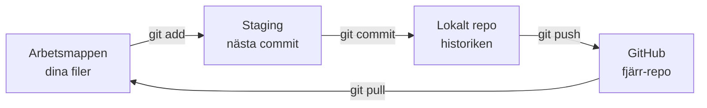
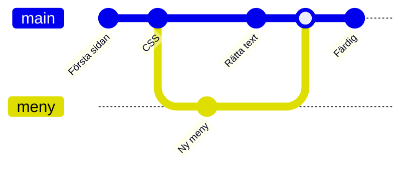

# Kapitel 6: Versionshantering med Git och GitHub

> **I det här kapitlet lär du dig**
> - varför versionshantering behövs
> - att spara ändringar med commit, push och pull
> - att arbeta i grenar och slå ihop dem
> - att lösa en konflikt
> - att hålla hemligheter utanför ditt repo

Har du någonsin haft filerna `uppsats_final.docx`, `uppsats_final2.docx` och `uppsats_final_FINAL.docx`? Då har du gjort versionshantering för hand, och du vet hur illa det fungerar. Git löser det problemet åt dig, och det är ett verktyg du nästan säkert kommer att använda om du fortsätter programmera.

## Vad är versionshantering?

Ett **versionshanteringssystem** håller reda på alla versioner av filerna i ett projekt. Du kan se vad som ändrats, av vem och varför, och du kan gå tillbaka till tidigare versioner. Du kan också arbeta flera personer i samma kod utan att skriva över varandras ändringar.

- **Git** är programmet som gör jobbet på din dator.
- **GitHub** är en webbtjänst där du lagrar Git-projekt och samarbetar. Det är där du lämnar in dina uppgifter och där du kan visa upp vad du har byggt.

Ett projekt i Git kallas ett **repository**, eller **repo**. Det är en vanlig mapp med en dold undermapp, `.git`, där hela historiken ligger.

## De tre områdena

När du arbetar med Git rör sig ändringarna genom tre steg:



Tanken är att du väljer exakt vad som ska ingå i nästa version. En **commit** är en sparad ögonblicksbild av projektet, med ett meddelande som beskriver ändringen.

## Genomgånget exempel: en vanlig arbetsdag

Du har precis gjort klart en CSS-övning. Så här skickar du upp den från terminalen:

```bash
git status                           # Vad har ändrats?
git add style.css index.html         # Välj filer till nästa commit
git commit -m "Lägg till meny med Flexbox"
git push                             # Skicka till GitHub
```

Dagen efter sitter du vid en annan dator:

```bash
git clone https://github.com/ditt-konto/mitt-projekt.git   # Hämta projektet första gången
cd mitt-projekt
git pull                                                   # Hämta senaste ändringarna
```

`clone` gör du en gång per dator. `pull` gör du innan du börjar arbeta. Samma sak går att göra i Visual Studio Code i fliken Source Control: plustecknet motsvarar `git add`, och Commit- och Sync-knapparna motsvarar `git commit` och `git push`. Det är bra att lära sig båda sätten, eftersom terminalen visar vad som händer och felmeddelandena förklarar mer där.

**Skriv bra commit-meddelanden.** "fix" säger ingenting om ett halvår. "Rätta gränsvärdet så att 25 grader räknas som lagom" säger exakt vad som hänt. Skriv helst en commit per logisk ändring och skriv i imperativ form, som i exemplet.

## Grenar

En **gren** (branch) är en parallell utvecklingslinje. Med en gren kan du prova en ny funktion utan att röra den kod som fungerar. När du är klar slår du ihop den med huvudgrenen genom en **merge**.



```bash
git switch -c meny        # Skapa grenen meny och byt till den
# ... arbeta och gör commits ...
git switch main           # Tillbaka till huvudgrenen
git merge meny            # Slå ihop meny med main
git branch -d meny        # Ta bort grenen när du är klar
```

I ett grupparbete brukar man låta varje funktion ha sin gren. På GitHub kan du föreslå att den ska slås ihop med en **pull request**, där andra kan läsa och kommentera koden först.

## Konflikter

Om två personer ändrat samma rad kan Git inte veta vilken version som är rätt. Det kallas en **konflikt**, och det är ingenting farligt. Git markerar stället i filen:

```text
<<<<<<< HEAD
  <h1>Temperaturvakt</h1>
=======
  <h1>Temperaturmätare</h1>
>>>>>>> meny
```

Delen mellan `<<<<<<<` och `=======` är din version och delen mellan `=======` och `>>>>>>>` är den som ska slås in. Så här löser du den:

1. Bestäm vilken text som ska stå kvar, eller kombinera dem.
2. Ta bort markeringsraderna.
3. Spara och kör `git add` på filen.
4. Avsluta med `git commit`.

VS Code visar knappar för att acceptera den ena eller andra versionen, men kontrollera alltid resultatet. Testa att programmet fungerar innan du pushar.

## Vad ska inte in i ett repo?

Filen `.gitignore` listar filer som Git ska strunta i, till exempel `.DS_Store`, `node_modules` och filer med lösenord.

```text
.DS_Store
node_modules/
secrets.h
.env
```

Var extra försiktig med **hemligheter** som lösenord till Wi-Fi och API-nycklar. Skriv dem aldrig direkt i kod som du pushar. Det räcker inte med att ta bort en nyckel i en senare commit, för den finns kvar i historiken. Har en nyckel kommit ut på GitHub ska du behandla den som röjd och skapa en ny.

## Git som en del av arbetssättet

Versionshantering är ett arbetssätt, inte bara ett sätt att lämna in. Gör en commit varje gång något fungerar, och pusha i slutet av varje lektion. Då blir alltid den senaste fungerande versionen sparad, och du kan gå tillbaka om något går sönder. Med `git log --oneline` ser du din historik och med `git diff` vad du har ändrat sedan senaste commit.

## Begrepp

- **Versionshantering:** ett system som sparar alla versioner av ett projekt
- **Repository (repo):** ett projekt som hanteras av Git
- **Commit:** en sparad ögonblicksbild med ett meddelande
- **Push och pull:** att skicka till och hämta från ett fjärr-repo
- **Clone:** att ladda ner ett repo för första gången
- **Gren (branch):** en parallell utvecklingslinje
- **Merge:** att slå ihop två grenar
- **Konflikt:** när Git inte kan slå ihop ändringar själv
- **.gitignore:** en fil som listar vad Git inte ska spara

## Testa dig själv

1. Vad är skillnaden mellan Git och GitHub?
2. Vad händer i de tre områdena när du ändrar en fil och sparar den med `git add` och `git commit`?
3. Vad är skillnaden mellan `git commit` och `git push`?
4. Varför är "fix" ett dåligt commit-meddelande?
5. Varför arbetar man i grenar i ett grupparbete?
6. Hur uppstår en konflikt och vad gör du för att lösa den?
7. Varför räcker det inte att ta bort en nyckel i en senare commit?

## Övningar

Kursens guide finns i mappen [Git-Github](https://github.com/abbindustrigymnasium/programmering1/tree/main/Git-Github) och visar stegen både i terminalen och i VS Code.

**Grund 1.** Skapa ett repo, lägg till en HTML-fil, gör en commit och pusha till GitHub. Titta på resultatet på github.com.

**Grund 2.** Ändra filen direkt på github.com och hämta ändringen med `git pull`. Kör `git log --oneline` och beskriv vad du ser.

**Grund 3.** Skapa en `.gitignore` som utesluter `secrets.h`. Skapa filen och visa med `git status` att Git inte bryr sig om den.

**Vidare 4.** Skapa en gren, gör två commits på den och slå ihop den med `main`.

**Vidare 5.** Skapa med flit en konflikt: ändra samma rad på två grenar och slå ihop dem. Lös konflikten för hand.

**Utmaning 6.** Samarbeta med en kompis i samma repo. Båda arbetar i egna grenar och gör en pull request till `main`. Granska varandras kod och kommentera innan ni slår ihop.

## Koppling till projektet

Kapitlet hör till projektet [Versionshantering](../projekt/versionshantering/README.md) och används i alla andra projekt, eftersom koden i kursen lämnas in på GitHub. I [Hetaste Laget PROG](../projekt/hetaste-laget/README.md) är det särskilt viktigt att hålla Wi-Fi-lösenord och nycklar utanför repot.

## Läs mer

- [Pro Git, gratis bok på webben](https://git-scm.com/book/en/v2)
- [GitHub Docs: Hello World](https://docs.github.com/en/get-started/start-your-journey/hello-world)
- [VS Code: Källkontroll](https://code.visualstudio.com/docs/sourcecontrol/overview)

[← Föregående](05-dom-och-granssnitt.md) | [Innehåll](../README.md) | [Nästa →](07-esp8266-och-cpp.md)
