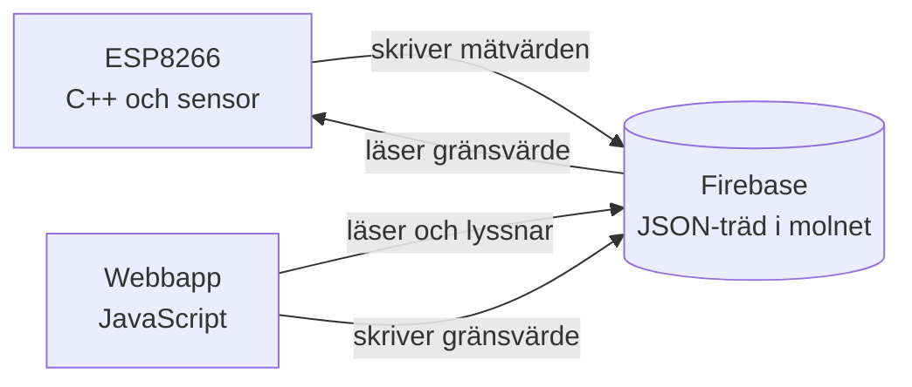

# Kapitel 8: HTTP, databaser och webbappar

> **I det här kapitlet lär du dig**
> - hur HTTP-förfrågningar och svar fungerar
> - vad ett API är och hur du använder JSON
> - hur asynkron kod fungerar med `fetch` och `async/await`
> - hur en databas i molnet kopplar ihop din mikrokontroller med webbappen
> - hur du bygger en webbapp som användaren kan styra

Ditt program på ESP8266 kan nu läsa en temperatur, och du kan bygga en webbsida. Men de två vet ingenting om varandra. Det här kapitlet handlar om bron mellan dem: hur program pratar med varandra över nätet.

## HTTP: frågor och svar

**HTTP** är protokollet som webben använder. Ett **protokoll** är en överenskommelse om hur meddelanden ska se ut. Klienten skickar en **förfrågan** och servern svarar med ett **svar**.

Varje förfrågan har en **metod** som säger vad klienten vill göra:

| Metod | Betydelse | Exempel |
|---|---|---|
| GET | Hämta | Hämta senaste temperaturen |
| POST | Skapa | Lägg till en ny mätning |
| PUT eller PATCH | Ändra | Ändra gränsvärdet |
| DELETE | Ta bort | Radera en mätning |

Svaret har en **statuskod** som säger hur det gick:

| Kod | Betydelse |
|---|---|
| 200 | OK |
| 201 | Skapad |
| 400 | Felaktig förfrågan |
| 401 eller 403 | Saknar behörighet |
| 404 | Finns inte |
| 500 | Fel på servern |

Du kan se allt detta själv i fliken Network i webbläsarens utvecklarverktyg.

## API:er och JSON

Ett **API** (Application Programming Interface) är ett bestämt sätt för program att använda varandra. Ett webb-API tar emot HTTP-förfrågningar och svarar oftast med data i formatet **JSON**, som ser ut som JavaScript-objekt men är ren text:

```json
{
  "rum": "A12",
  "temperatur": 21.5,
  "larm": false
}
```

Text är lätt att skicka mellan olika språk och system. Din C++-kod, din JavaScript och databasen kan alla läsa samma JSON.

## Asynkron kod

Att hämta data över nätet kan ta en stund. Om programmet väntade rad för rad skulle hela sidan frysa. JavaScript löser det med **asynkron** kod: du startar en operation och programmet går vidare, och när svaret kommer körs resten av koden.

En **Promise** är ett löfte om ett värde som kommer senare. Med `async` och `await` kan du ändå skriva kod som läses uppifrån och ned. `await` betyder "vänta in det här löftet, men låt resten av sidan fortsätta under tiden".

**Genomgånget exempel.** Vi hämtar en post från JSONPlaceholder, ett gratis test-API:

```js
async function hamtaUppgift(id) {
  const svar = await fetch(`https://jsonplaceholder.typicode.com/todos/${id}`);
  if (!svar.ok) {
    throw new Error(`Servern svarade med status ${svar.status}`);
  }
  return svar.json();
}

async function visaUppgift() {
  try {
    const uppgift = await hamtaUppgift(1);
    console.log(uppgift.id, uppgift.title);
  } catch (fel) {
    console.log("Kunde inte hämta uppgiften:", fel.message);
  }
}

visaUppgift();
```

Gå igenom vad som händer:

1. `fetch` skickar en GET-förfrågan och returnerar en Promise.
2. `await` väntar på svaret utan att blockera sidan.
3. `fetch` räknar bara nätverksfel som fel. En 404 kommer tillbaka som ett vanligt svar, och därför kontrollerar vi `svar.ok` själva och kastar ett undantag.
4. `svar.json()` tolkar texten som JSON.
5. `try` och `catch` fångar både nätverksfel och vårt eget undantag, enligt [kapitel 4](04-problemlosning-och-felsokning.md).

Ändra `1` till `9999` och se vad som händer: API:et svarar 404 och `catch` skriver ut felmeddelandet.

Vill du skicka data använder du `fetch` med `method: "POST"` och skickar med en `body` som görs om till text med `JSON.stringify(...)`.

## Databasen i mitten

En **databas** är ett program som sparar data på ett strukturerat sätt och låter andra program söka i den. I temperaturprojektet använder kursens exempel **Firebase Realtime Database**, en databas i molnet där all data ligger i ett stort JSON-träd:

```json
{
  "sensor": {
    "temperatur": 21.5,
    "luftfuktighet": 40
  },
  "installningar": {
    "grans": 25
  }
}
```

Du pekar ut en plats med en **sökväg**. `/sensor/temperatur` ger värdet 21.5.

Det finns inget direkt samtal mellan ESP8266 och webbsidan. Båda läser och skriver på samma ställe i databasen:



Med biblioteket Firebase-ESP8266 skriver mikrokontrollern så här:

```cpp
if (!Firebase.setFloat(firebaseData, "/sensor/temperatur", temperatur)) {
  Serial.println(firebaseData.errorReason());
}
```

Webbsidan kan lyssna på samma sökväg och uppdateras så fort värdet ändras:

```js
db.ref("sensor").on("value", (snapshot) => {
  const data = snapshot.val();
  document.querySelector("#temp").textContent = `${data.temperatur} °C`;
});
```

Bakom biblioteken ligger HTTP. Firebase har ett **REST-API**, vilket betyder att varje sökväg kan nås med en vanlig förfrågan, till exempel en GET mot `/sensor.json` på din databas. Testa gärna adressen i webbläsaren eller med `fetch` om dina regler tillåter det.

**Säkerhet.** Under fliken Rules i Firebase-konsolen bestämmer du vem som får läsa och skriva. Webbkonfigurationen med `apiKey` hamnar alltid hos besökaren, så det är reglerna som skyddar databasen. En databas öppen för alla kan vem som helst ändra eller radera. Wi-Fi-lösenord och liknande ska inte heller ligga i repot.

## Webbappen

En **webbapp** är en webbsida som beter sig som ett program. Du kan bygga den med ren HTML, CSS och JavaScript, gärna med **Bootstrap** för färdig design, eller med ramverket **Vue**.

Med **Vue** beskriver du hur sidan ska se ut utifrån data, och Vue uppdaterar sidan när datan ändras. Det kallas **reaktivitet**:

```html
<div id="app">
  <p>Temperatur: {{ temperatur }} °C</p>
  <p v-if="forVarmt">Varning: över gränsvärdet.</p>
  <label>
    Gränsvärde (°C)
    <input type="number" v-model.number="grans">
  </label>
</div>

<script src="https://unpkg.com/vue@3/dist/vue.global.prod.js"></script>
<script>
  const { createApp, ref, computed } = Vue;

  createApp({
    setup() {
      const temperatur = ref(21.5);
      const grans = ref(25);
      const forVarmt = computed(() => temperatur.value > grans.value);
      return { temperatur, grans, forVarmt };
    },
  }).mount("#app");
</script>
```

`ref` skapar ett reaktivt värde, `v-model` kopplar fältet till `grans` i båda riktningarna, och `computed` räknas om automatiskt. Jämför med hur mycket kod samma sak tog i [kapitel 5](05-dom-och-granssnitt.md).

Oavsett verktyg, tänk på användaren: visa det viktigaste värdet först, med enhet, och tala om när det är gammalt. Om anslutningen är borta ska sidan säga det, inte visa en gammal temperatur som om den vore ny.

## Begrepp

- **HTTP:** protokollet för förfrågningar och svar på webben
- **Statuskod:** ett tal i svaret som säger hur det gick
- **API:** ett bestämt sätt för program att använda varandra
- **JSON:** ett textformat för strukturerad data
- **Asynkron kod:** kod där programmet kan fortsätta medan något tar tid
- **Promise:** ett löfte om ett värde som kommer senare
- **Databas:** ett program som lagrar och hämtar data
- **Reaktivitet:** att sidan uppdateras automatiskt när datan ändras

## Testa dig själv

1. Vad är skillnaden mellan GET och POST?
2. Vad betyder statuskoderna 200, 404 och 500?
3. Varför kan inte din webbsida bara vänta rad för rad på svaret från ett API?
4. Varför behöver du själv kontrollera `svar.ok` när du använder `fetch`?
5. Varför pratar ESP8266 och webbappen inte direkt med varandra i projektet?
6. Vad skyddar databasen, och varför är det inte `apiKey`?
7. Vad betyder att ett ramverk är reaktivt?

## Övningar

Övningarna finns i [HTTP och API:er](https://github.com/abbindustrigymnasium/programmering1/tree/main/HTTP%20och%20APIer/%C3%96vningar), i [temperaturprojektets Firebase-övningar](https://github.com/abbindustrigymnasium/programmering1/tree/main/Projekt-Temperatur-Sensor/Exempel/%C3%96vningar) och i [Vue-mappen](https://github.com/abbindustrigymnasium/programmering1/tree/main/Vue).

**Grund 1.** Gör övningarna i HTTP och API:er: `setTimeout` med callback och `fetch` mot JSONPlaceholder.

**Grund 2.** Hämta en lista från `/todos` och visa de fem första titlarna på din sida med hjälp av DOM.

**Vidare 3.** Hämta data från ett annat öppet API. Vad händer i din app om nätet är nere?

**Vidare 4.** Få igång [exemplet i temperaturprojektets mapp](https://github.com/abbindustrigymnasium/programmering1/tree/main/Projekt-Temperatur-Sensor/Exempel), så att du kan tända och släcka lysdioden från webbsidan.

**Utmaning 5.** Lägg till en parameter i webbappen, till exempel ett gränsvärde, som sparas i databasen och läses av ESP8266 så att kortet ändrar sitt beteende.

## Koppling till projektet

Kapitlet täcker delarna HTTP, databas och webbapp i [Hetaste Laget PROG](../projekt/hetaste-laget/README.md). Samma sätt att anropa ett API används senare i [Generativ AI](../projekt/generativ-ai/README.md).

## Läs mer

- [MDN: En översikt av HTTP](https://developer.mozilla.org/en-US/docs/Web/HTTP/Guides/Overview)
- [javascript.info: Fetch](https://javascript.info/fetch)
- [Firebase Realtime Database: dokumentation](https://firebase.google.com/docs/database)
- [Vue: Quick Start](https://vuejs.org/guide/quick-start.html)
- [Kursens Bootstrap-material](https://github.com/abbindustrigymnasium/programmering1/tree/main/Bootstrap)

[← Föregående](07-esp8266-och-cpp.md) | [Innehåll](../README.md) | [Nästa →](09-spel-och-objekt-i-godot.md)
