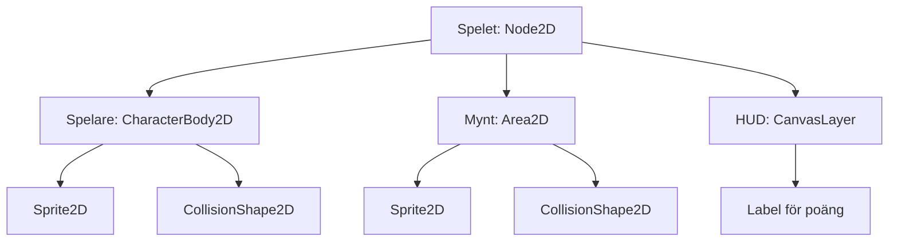
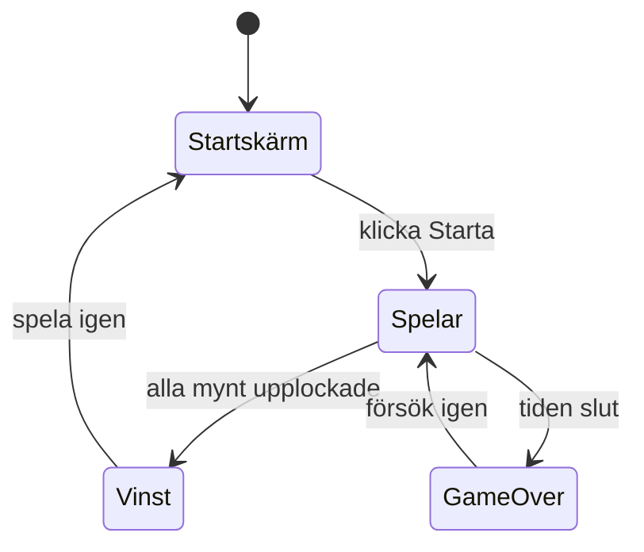

# Kapitel 9: Spel och objekt i Godot

> **I det här kapitlet lär du dig**
> - hur ett spel hela tiden uppdaterar sig i en spelloop
> - vad objektorientering är och hur Godots noder och scener bygger på det
> - att skriva rörelse i GDScript och förstå `delta`
> - att låta objekt kommunicera med signaler
> - att planera, testa och exportera ett spel

Ett spel är ett av de roligaste programmen att skriva och ett av de svåraste att få rätt, eftersom så mycket händer på samma gång. Spelaren flyttar sig, fiender rör sig, poängen räknas och musik spelas. I det här kapitlet ser du hur en spelmotor håller ordning på allt detta, och hur du strukturerar din kod.

## Spelloopen

Ett spel körs i en **spelloop**, som upprepas många gånger per sekund:

```text
upprepa så länge spelet körs:
    läs indata från spelaren
    uppdatera positioner, poäng och fiender
    kontrollera kollisioner och vinstvillkor
    rita bilden på skärmen
```

Du behöver inte skriva loopen själv. Motorn **Godot** gör det och anropar dina funktioner vid rätt tillfälle. `_ready()` körs en gång när ett objekt läggs till i spelet, ungefär som `setup()`, och `_process(delta)` eller `_physics_process(delta)` körs varje bildruta, ungefär som `loop()`.

## Objektorientering

**Objektorienterad programmering (OOP)** går ut på att bygga program av objekt som innehåller både data och beteende. I ett spel är det väldigt naturligt: en fiende har en position (data) och kan röra sig (beteende).

| Begrepp | Förklaring | I ett spel |
|---|---|---|
| **Klass** | En ritning för objekt | Skriptet för fienden |
| **Objekt (instans)** | Något skapat utifrån ritningen | Fiende nummer tre på banan |
| **Arv** | En klass bygger vidare på en annan | Skriptet börjar med `extends Area2D` |
| **Inkapsling** | Objektet sköter sina egna data | Spelaren ändrar sitt eget liv, andra skickar en signal |
| **Polymorfism** | Olika objekt kan svara olika på samma meddelande | Både mynt och fiende reagerar på `body_entered`, men på olika sätt |

## Noder och scener

I Godot byggs allt av **noder**. Varje nod gör en sak: `Sprite2D` visar en bild, `CollisionShape2D` beskriver en form för kollisioner och `AudioStreamPlayer` spelar ljud. Noder sätts ihop i ett träd som kallas en **scen**. Sedan kan du använda samma scen på många ställen i spelet.



## GDScript och rörelse

**GDScript** är Godots eget språk och påminner om Python: det använder indrag i stället för klamrar. Varje skript är en klass och börjar med `extends`, som talar om vilken nod den ärver från. Exemplen i det här kapitlet använder Godot 4.

```gdscript
extends CharacterBody2D

@export var hastighet := 200.0

func _physics_process(_delta):
	var riktning := Input.get_vector("ui_left", "ui_right", "ui_up", "ui_down")
	velocity = riktning * hastighet
	move_and_slide()
```

- `@export` gör att värdet kan ändras i editorn utan att ändra koden.
- `Input.get_vector` ger en riktning utifrån tangenterna. Ligger två tangenter nere samtidigt justeras längden, så spelaren inte går snabbare diagonalt.
- `move_and_slide()` flyttar kroppen med `velocity` och hanterar kollisioner.

**Genomräknat exempel: varför `delta`?** Om du flyttar något själv, till exempel en nod utan fysik, måste du tänka på att olika datorer visar olika många bildrutor per sekund. `delta` är tiden sedan senaste bildrutan, i sekunder.

```gdscript
extends Node2D

@export var hastighet := 200.0

func _process(delta):
	position.x += hastighet * delta
```

| Bildrutor per sekund | `delta` | Flytt per bildruta | Flytt per sekund |
|---|---|---|---|
| 60 | 1/60 s | 200 · 1/60 ≈ 3,33 px | 200 px |
| 30 | 1/30 s | 200 · 1/30 ≈ 6,67 px | 200 px |

Spelet går lika fort på båda datorerna. Utan `delta` skulle spelet på den snabbare datorn gå dubbelt så fort.

## Signaler

En **signal** är ett meddelande som ett objekt skickar när något har hänt. Andra objekt kan lyssna utan att avsändaren behöver veta vilka de är. Det är samma händelsestyrda tanke som `addEventListener` i [kapitel 5](05-dom-och-granssnitt.md).

Så här kan ett mynt tala om att det blivit upplockat:

```gdscript
extends Area2D

signal plockad_upp

func _on_body_entered(body):
	if body.is_in_group("spelare"):
		plockad_upp.emit()
		queue_free()
```

Du kopplar signalen `body_entered` till funktionen i editorns flik Node. Den huvudsakliga spelscenen lyssnar på `plockad_upp` och räknar poäng:

```gdscript
extends Node2D

var poang := 0

func _on_mynt_plockad_upp():
	poang += 1
	$HUD/PoangEtikett.text = "Poäng: %d" % poang
	if poang >= 5:
		get_tree().change_scene_to_file("res://vinst.tscn")
```

## Planera med tillstånd

Ett spel byter hela tiden tillstånd. Innan du skriver kod kan du rita ett **tillståndsdiagram**. Det är ett sätt att använda diagramteknik, som du lärde dig i [kapitel 4](04-problemlosning-och-felsokning.md):



Med pseudokod och diagram kan du se hålen i din plan innan du byggt fel sak. Vad händer till exempel om spelaren dör samtidigt som sista myntet plockas upp?

Andra viktiga delar av spelet är startskärm och game over-skärm, som byggs med **kontrollnoder** som `Button` och `Label`, ljud med `AudioStreamPlayer` samt byten mellan scener. Starta om en bana med `get_tree().reload_current_scene()`.

## Testa, felsök och exportera

Rutan Output visar utskrifter från `print()` och fel. Med debuggern kan du sätta brytpunkter precis som i webbläsaren. Vanliga fel är att en signal inte är kopplad, att ett nodnamn är felstavat så att `$`-sökvägen ger `null`, eller att en kollisionsform saknas. Felmeddelanden som säger *null instance* betyder nästan alltid det.

Låt någon annan spela. Du vet hur spelet fungerar, men det gör inte de. Ser de vad de ska göra utan att du förklarar? Går det att styra som de väntar sig?

När spelet är klart exporterar du det till en körbar fil via Project och Export. Första gången behöver du ladda ner Godots exportmallar. Det är steget där motorn packar ihop din kod och dina resurser för ett visst operativsystem, och det visar samspelet mellan program, motor och system.

## Begrepp

- **Spelloop:** den upprepning som läser indata, uppdaterar spelet och ritar om bilden
- **Klass och objekt:** en ritning och något skapat utifrån den
- **Arv:** att en klass bygger vidare på en annan
- **Nod och scen:** en byggsten i Godot och ett träd av byggstenar
- **Delta:** tiden sedan senaste bildrutan
- **Signal:** ett meddelande som ett objekt skickar när något händer
- **Tillståndsdiagram:** en bild av vilka lägen ett program kan vara i och hur det går mellan dem

## Testa dig själv

1. Vilka steg ingår i en spelloop?
2. Vad är skillnaden mellan en klass och ett objekt? Ge ett exempel från ett spel.
3. Vad är skillnaden mellan en nod och en scen?
4. Varför multiplicerar man med `delta`?
5. Varför är signaler bättre än att spelaren ändrar poängen direkt?
6. Vad kan ett *null instance*-fel bero på?
7. Varför är det viktigt att någon annan testar ditt spel?

## Koppling till projektet

Kapitlet förbereder [2D-Spel](../projekt/2d-spel/README.md), där du planerar, bygger och exporterar ett eget spel. Vill du läsa mer om OOP finns genomgångar i kursens [mapp om objektorienterad programmering](https://github.com/abbindustrigymnasium/programmering1/tree/main/Object-Orienterad-Programmering).

## Läs mer

- [Godot Docs: Getting started](https://docs.godotengine.org/en/stable/getting_started/introduction/index.html)
- [Godot Docs: GDScript](https://docs.godotengine.org/en/stable/tutorials/scripting/gdscript/gdscript_basics.html)
- [GDScript-tutorials](https://gdscript.com/tutorials/)
- [Kursens guide till Godot och kraven på spelet](https://github.com/abbjetmus/Godot-2D-Spel)

[← Föregående](08-http-databas-webbapp.md) | [Innehåll](../README.md) | [Nästa →](10-generativ-ai-och-etik.md)
